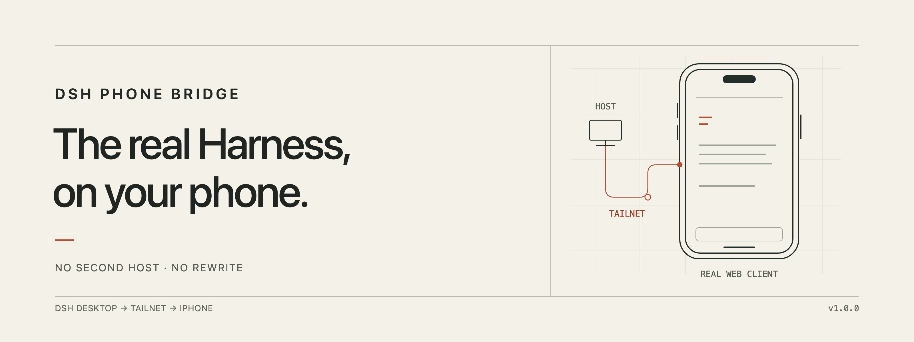
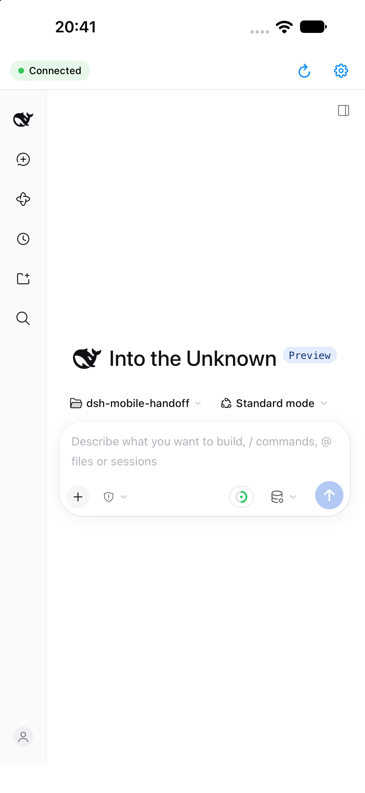

<p align="center">
  
</p>

<h1 align="center">DSH Phone Bridge</h1>

<p align="center">
  <strong>The real DeepSeek Harness UI. On your iPhone. Over Tailscale.</strong>
</p>

<p align="center">
  
  
  
  
  
</p>

---

DSH Phone Bridge is a small Host plugin plus a SwiftUI iPhone app that opens the
**real DeepSeek Harness Desktop UI** on your phone. It does not run a second
Host, copy your sessions, or reimplement the client. The Desktop Host remains the
only writer; the phone is a secure window into it.

Tailscale is the network boundary. The bridge opens exactly one listener on a
`100.64.0.0/10` address, gates it with a paired-device cookie, and reverse-proxies
HTTP and WebSocket traffic into the Host's existing loopback server.

<p align="center">
  
</p>

<p align="center"><em>The real web client, rendered by the iPhone app and connected to the desktop Host.</em></p>

## Why this exists

The shipped DSH web client already knows how to render sessions, tools,
terminal output, approvals, plans, jobs, and subagents. Rebuilding that on iOS
would be a permanent catch-up game. Running a second Host on the tailnet would
create a second writer and a different profile.

So the bridge does the smallest useful thing:

- **one Host**, the one you already use;
- **one tailnet listener**, bound to one address;
- **one real UI**, rendered in `WKWebView`;
- **one device credential**, stored in the iPhone Keychain.

## What you get

- **The real client.** No native reimplementation, no reduced “mobile mode.”
- **Tailscale-only by construction.** No `0.0.0.0`, no LAN fallback, no public
  port. Startup refuses anything outside `100.64.0.0/10`.
- **Pair once.** Scan a QR in **Settings → Phone**. Manual code and paste-link
  fallbacks are built in.
- **Fast, clean revocation.** Revoking a device invalidates its next request
  immediately and closes every WebSocket it owns.
- **A phone that behaves like a console.** Foreground reconnect, offline banner,
  reload, and a settings sheet with live diagnostics.
- **No launch token on the phone.** The Host launch token never leaves the
  desktop process; the Host cookie is injected only on the loopback side.

## How it works

```text
┌──────────────────────────────┐
│ iPhone                        │
│ SwiftUI shell + WKWebView     │
│ dsh-phone cookie in Keychain  │
└──────────────┬───────────────┘
               │ Tailscale (WireGuard)
               ▼
┌──────────────────────────────┐
│ Host plugin                  │
│ 100.64.x.x:8787              │
│ device-cookie gate           │
│ HTTP + WebSocket reverse     │
│ proxy, header rewriting      │
└──────────────┬───────────────┘
               │ loopback only
               ▼
┌──────────────────────────────┐
│ Running DSH Desktop Host     │
│ sessions, tools, approvals   │
└──────────────────────────────┘
```

The phone never sees the Host's loopback port, launch token, or `dsh-auth-…`
cookie. The plugin replaces the phone cookie with the Host cookie on the way in,
and strips every `Set-Cookie` on the way out.

## Install

### 1. Host plugin

```sh
git clone https://github.com/Adolanium/dsh-phone.git
cd dsh-phone
sh scripts/install-dev.sh
```

Restart DeepSeek Harness when no turn or job is running. Open **Settings →
Phone**. The page shows the tailnet address, a live QR, the pairing code, the
device list, and diagnostics.

Windows PowerShell equivalents are in `scripts/install-dev.ps1` and
`scripts/uninstall-dev.ps1`; they are provided but have not been exercised on
Windows.

### 2. iPhone app

```sh
cd apps/ios
open DSHPhone.xcodeproj
```

Set your Apple team in **Signing & Capabilities**, choose your iPhone, and Run.
The app targets iOS 17+ and has no third-party dependencies.

For the Simulator:

```sh
xcodebuild \
  -project DSHPhone.xcodeproj \
  -scheme DSHPhone \
  -sdk iphonesimulator \
  -destination 'platform=iOS Simulator,name=iPhone 18 Pro Max,OS=27.0' \
  -derivedDataPath build \
  build
```

See [apps/ios/README.md](apps/ios/README.md) for signing, Simulator pairing, and
the debug launch seams.

### 3. Pair

1. Open **Settings → Phone** in DSH.
2. In the app, point the camera at the QR.
3. Or enter the 8-character code manually, or paste a `dshphone://pair` link.

The QR code is single-use and expires after 120 seconds. The resulting device
cookie is stored in the Keychain and in WebKit's cookie store.

## Security model

| Property | How it is enforced |
|---|---|
| Tailscale-only | Listener binds one asserted `100.64.0.0/10` address; no wildcard or loopback fallback |
| No public exposure | No Funnel, no port forwarding, no LAN bind |
| Launch token never leaves the Host | Minted in-process; used only for the loopback cookie exchange |
| Host cookie never reaches the phone | Injected upstream; every upstream `Set-Cookie` stripped |
| Device credential at rest | 32 random bytes; only a SHA-256 hash is stored on the Host |
| Pairing codes | 8 Crockford base32 characters; 120 s; single use; hashed in memory; rate-limited |
| Admin surface | Loopback-only, `x-dsh-phone-admin: 1`, known Origin, no CORS |
| Revocation | Next request is 401; upgraded sockets are destroyed immediately |
| Phone storage | Device cookie in the Keychain; no token in `UserDefaults` or URLs |
| Pairing page | Code travels in the URL fragment, never in a request line or log |

## Inside the repo

```text
apps/ios/                  SwiftUI app, Xcode project, tests
packages/dsh-plugin-phone-bridge/
  lib/                     Host plugin, proxy, pairing, QR, Settings UI
  test/                    80 node:test cases
scripts/                   install/uninstall for macOS/Linux and Windows
docs/banner.png            README hero
```

## Development

```sh
node --test packages/dsh-plugin-phone-bridge/test
# tests 80, pass 80

cd apps/ios
xcodebuild \
  -project DSHPhone.xcodeproj \
  -scheme DSHPhone \
  -sdk iphonesimulator \
  -destination 'platform=iOS Simulator,name=iPhone 18 Pro Max,OS=27.0' \
  -derivedDataPath build \
  test
# 5 PairingLink tests, 5 pass
```

The plugin has no runtime dependencies. The iOS app has no third-party
dependencies. The plugin's tests run without a tailnet, using a mock upstream.

## Status

**1.0.0.** Verified on macOS 27 with a physical iPhone 14 Pro Max (iOS 27.0.1)
and the iOS 27 Simulator.

Known limits:

- The listener port is configured in the profile (default `8787`), not exposed
  in the app.
- No push notifications yet; approvals appear when the app is foregrounded.
- Windows installers exist but are unexercised.
- Forced Tailscale outage and host sleep/wake are not part of the automated
  test suite.

## License

MIT © [Adolanium](https://github.com/Adolanium)
